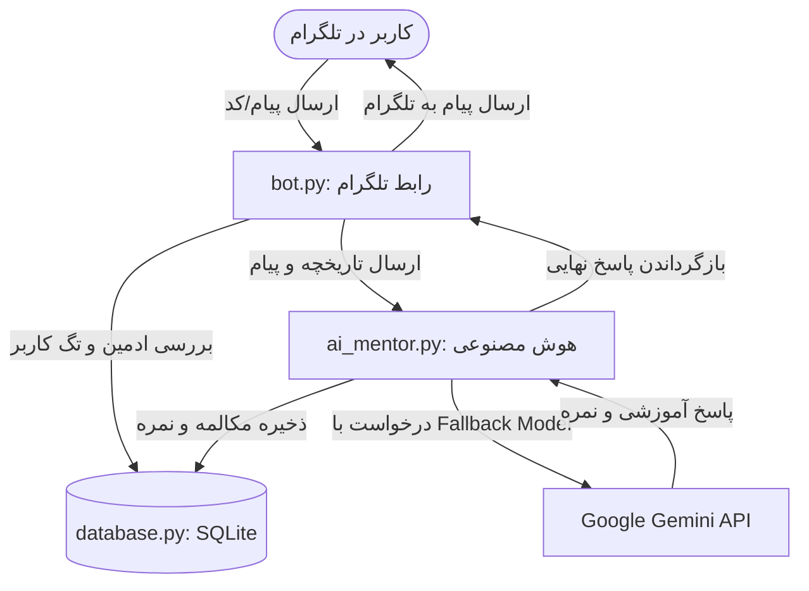

<div align="center">

# 🚀 AI Software Engineering Mentor Bot

[](https://www.python.org/)
[](https://core.telegram.org/bots)
[](https://ai.google.dev/)
[](https://www.sqlite.org/)
[](https://www.linux.org/)
[](LICENSE)

یک منتور هوشمند و تعاملی مبتنی بر تلگرام و **Google Gemini API** برای یادگیری عمیق مهندسی نرم‌افزار (**Python, OOP, SQL, Linux, Git**) با متدولوژی ۳ مرحله‌ای.

</div>

---

## 📊 معماری جریان داده‌ها (System Architecture)

نمودار زیر نحوه تعامل لایه‌های مختلف پروژه (تلگرام، پایتون، دیتابیس و هوش مصنوعی) را نشان می‌دهد:



---

## ✨ ویژگی‌های کلیدی (Key Features)

* **🧠 چرخه یادگیری ۳ مرحله‌ای (3-Step Pedagogical Loop):**
  1. **آموزش و پرسش:** تدریس مبحث به زبان ساده همراه با ۳ سوال مفهومی.
  2. **تعریف تسک کدنویسی:** ارائه یک تمرین عملی متناسب با سطح یادگیری.
  3. **ریویو کد و نمره‌دهی خودکار (Automated Code Review & Grading):** بررسی خط‌به‌خط کد، ارائه بازخورد، و استخراج خودکار نمره (از ۱۰۰) با استفاده از Regex و ثبت در کارنامه.
* **🛡️ مدیریت امن دیتابیس با Context Manager:** پیاده‌سازی متدهای `__enter__` و `__exit__` در کلاس `DatabaseManager` جهت تضمین تراکنش‌های ایمن (`commit` / `rollback`) و جلوگیری از خطای `Database is locked`.
* **⚡ پایداری بالا با الگوی Fallback Model:** اولویت‌بندی هوشمند مدل‌های Gemini برای عبور خودکار از خطای ترافیک (`503 High Demand`) و پاسخ‌دهی در کمتر از ۳ ثانیه.
* **📊 سیستم کارنامه و رصد پیشرفت (`/stats`):** محاسبه میانگین نمرات و تاریخچه مباحث تکمیل‌شده برای هر کاربر.
* **👑 پنل مدیریت اختصاصی ادمین (`/users`):** گزارش تحلیلی کاربران کل و کاربران فعال در ۷ روز اخیر با منوی اختصاصی پویا (`BotCommandScopeChat`).

---

## 🏗️ ساختار پروژه (Project Structure)

```text
mentor-bot/
├── bot.py            # لایه رابط تلگرام، دستورات، منوی پویا و تقسیم پیام‌های طولانی
├── ai_mentor.py      # لایه هوش مصنوعی، پرامپت سیستم، مکانیزم Fallback و شکار نمره با Regex
├── database.py       # لایه داده (SQLite) همراه با Context Manager و جداول تخصصی
├── requirements.txt  # وابستگی‌های پروژه
├── .gitignore        # محافظت از فایل‌های حساس (.env و دیتابیس)
└── .env              # متغیرهای محیطی
```

---

## 🚀 راه‌اندازی و نصب (Installation & Setup)

### ۱. کلون کردن مخزن و ساخت محیط مجازی
```bash
git clone https://github.com/S3nsi0ne/mentor-bot.git
cd mentor-bot
python3 -m venv venv
source venv/bin/activate
pip install -r requirements.txt
```

### ۲. تنظیم متغیرهای محیطی (`.env`)
یک فایل به نام `.env` در ریشه پروژه بسازید:
```env
TELEGRAM_TOKEN=your_telegram_bot_token_here
GEMINI_API_KEY=your_gemini_api_key_here
ADMIN_ID=your_numeric_telegram_id
```

### ۳. اجرای بات
```bash
python3 bot.py
```

---

## 🖥️ استقرار دائمی روی سرور لینوکس (Systemd Deployment)

برای اجرای ۲۴ ساعته بات در پس‌زمینه سرور اوبونتو با راه‌اندازی مجدد خودکار (`Restart=always`):

```bash
sudo nano /etc/systemd/system/mentor-bot.service
```

محتوای فایل سرویس:
```ini
[Unit]
Description=Telegram AI Mentor Bot
After=network.target

[Service]
User=ssm-user
WorkingDirectory=/home/ssm-user/mentor-bot
ExecStart=/home/ssm-user/mentor-bot/venv/bin/python /home/ssm-user/mentor-bot/bot.py
Restart=always
RestartSec=5

[Install]
WantedBy=multi-user.target
```

فعال‌سازی و روشن کردن سرویس:
```bash
sudo systemctl daemon-reload
sudo systemctl enable --now mentor-bot.service
sudo systemctl status mentor-bot.service
```

---

## 🎮 دستورات بات (Bot Commands)

| دستور (Command) | دسترسی (Scope) | توضیحات (Description) |
| :--- | :--- | :--- |
| `/start` | عمومی (Public) | شروع کار با بات و نمایش راهنمای استفاده |
| `/stats` | عمومی (Public) | نمایش کارنامه، لیست مباحث تمرین‌شده و میانگین نمرات |
| `/reset` | عمومی (Public) | پاک کردن حافظه موقت چت فعلی برای شروع مبحث جدید (نمرات حفظ می‌شوند) |
| `/myid` | عمومی (Public) | دریافت آیدی عددی اکانت تلگرام |
| `/users` | **فقط ادمین (Admin Only)** | مشاهده لیست کل کاربران، وضعیت فعالیت در ۷ روز اخیر و تعداد پیام‌ها |